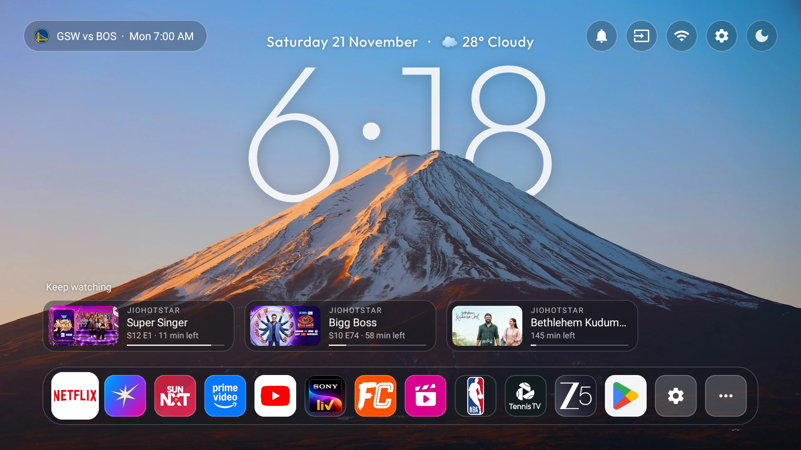
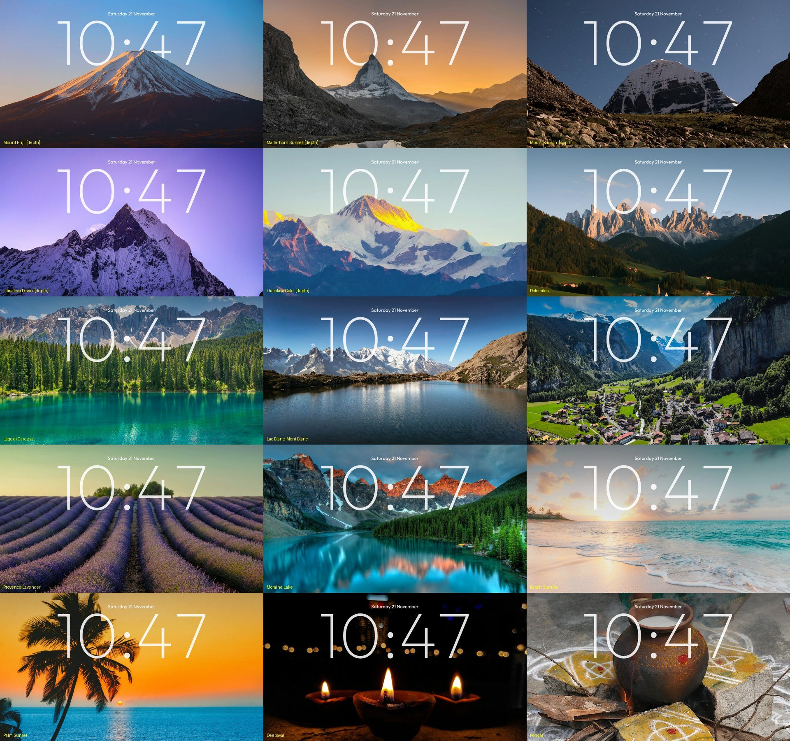
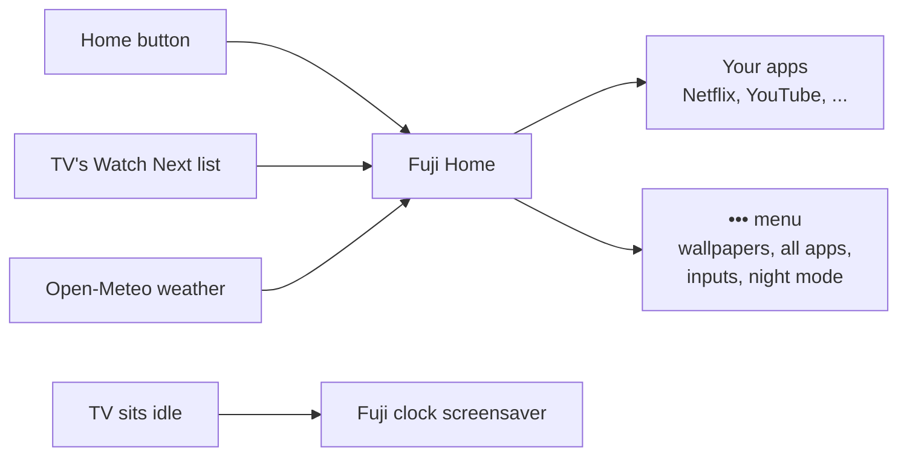

<div align="center">


# Fuji Home

**A calm, lock-screen style home screen for Android TV.**

[](#what-you-need)
[](#build-it-yourself)
[](#privacy)
[](https://github.com/Gathin23/cleanyourtv)
[](#license)

[What it is](#what-it-is) ·
[Install](#install-with-claude-code) ·
[Build](#build-it-yourself) ·
[Make it yours](#make-it-yours) ·
[Add-ons](#add-ons) ·
[Undo](#getting-your-old-home-back) ·
[Privacy](#privacy) ·
[FAQ](#faq) ·
[Credits](#credits)


<br><sub>Fuji Home on my own TV, with the NBA add-on switched on and my apps in the dock.</sub>

</div>

## What it is

Most Android TV home screens are a billboard. Rows of recommendations, sponsored tiles and trailers that start
playing on their own, and the app you wanted is somewhere three rows down. Fuji Home replaces all of that with
one quiet screen: a beautiful photo, a big clock, and the apps you actually use in a single row at the bottom.

The look comes from a phone's lock screen. On mountain wallpapers the peak stands *in front of* the time, so the
clock feels tucked into the scenery. That cut-out is prepared once on your computer, so the TV only stacks three
pictures and stays fast, even on older sets with 2 GB of RAM.

Above the dock is a Keep watching row, built from the TV's own list of shows you left halfway. The date line
shows today's weather for your city. The round buttons in the top corner open notifications, inputs (HDMI, AV,
Live TV), Wi-Fi and settings. Behind the ••• button are the wallpaper picker, all your apps and a night mode that
dims the screen. When the TV sits idle, the same clock becomes the screensaver and drifts to a new wallpaper
every ten minutes.

It works best together with a debloat. Most TVs ship with ad apps, trackers and background services nobody asked
for. The install prompt below switches those off (it never deletes them) using
[CleanYourTV](https://github.com/Gathin23/cleanyourtv)'s careful method, and the TV feels noticeably snappier
afterwards. Your streaming apps and their logins are never touched.

<div align="center">

<br><sub>The wallpapers that come with it. The mountains have the depth effect.</sub>
</div>

## Tested on a real TV, with a way back

Fuji Home runs every day on my family's TV, a 2 GB Android TV 10 set. It went through a full debloat, a launcher
swap and several restarts there, and Netflix, Hotstar, YouTube and the rest stayed logged in the whole time.

Before anything on the TV changes, the install prompt makes a full backup: every app and whether it was on or
off, all the TV's settings, the home screen and the screensaver. It also writes a restore script for that
exact TV. If you ever want things the way they were, you run that one script and it switches everything back.
It even refuses to run on a different TV by mistake. Nothing is uninstalled and no app's data is ever cleared,
so there's nothing that can't be undone, with the script or with just the remote.

## How it fits together



Fuji Home is an ordinary Android app that the TV uses as its home screen. Nothing is rooted or flashed. The old
home screen is only switched off, so it can be switched back on from Settings at any time.

## What you need

An Android TV or Google TV on Android 8.0 or newer. That covers Sony, TCL, Xiaomi, Hisense, Philips, Nvidia
Shield, Chromecast with Google TV and most others. Samsung (Tizen), LG (webOS), Roku and Fire TV run different
systems, so it won't work on those.

You also need a computer on the same Wi-Fi, and Developer options switched on once. On the TV, go to
**Settings → Device Preferences → About**, press OK on **Build** seven times, then go back into
**Developer options** and turn on **USB debugging** (and **Network debugging**, if your TV shows it).

## Install with Claude Code

The easiest way is to let [Claude Code](https://claude.com/claude-code) do it. Open a terminal, start Claude
Code, and paste the prompt from **[PROMPT.md](PROMPT.md)** with your TV's model filled in.

It connects to the TV, makes the backup and the restore script described above before changing anything. Then it asks
which apps you use, switches off the junk, builds Fuji Home with your city and your dock, and installs it. It
only makes Fuji Home the home screen after you say yes, and it switches debugging off again at the end. The
whole way it follows CleanYourTV's safety rules: switch off, never uninstall, and never touch what the TV needs
to run.

## Build it yourself

You need JDK 17 and the Android SDK with platform 34. On a Mac, Homebrew gets you both:

```bash
brew install openjdk@17 android-commandlinetools
sdkmanager "platforms;android-34" "build-tools;34.0.0" "platform-tools"
```

Then clone, build and install:

```bash
git clone https://github.com/PRODHOSH/fuji-home.git
cd fuji-home
./gradlew assembleRelease
adb connect <tv ip>:5555
adb install -r app/build/outputs/apk/release/app-release.apk
```

Open **Fuji Home** from the TV's app list to try it. Nothing about your TV changes until you make it the home
screen, and there are two ways to do that.

The gentle way is the built-in helper: **Settings → Accessibility → Fuji Home → On**. Whenever the old home
screen appears, the helper opens Fuji Home over it. The old one can flash for a moment, but nothing is switched
off, and turning the helper off undoes it.

The complete way is to switch the old launcher off with `pm disable-user`, which makes Fuji Home the only home
screen. Do this only after Fuji Home is installed and opens correctly; CleanYourTV's `tools/disable.sh` checks
that for you. To undo it, turn the old launcher back on in Settings → Apps. One rule matters here: **never
uninstall Fuji Home while the old launcher is switched off.** Turn the old one back on first.

## Make it yours

Everything personal lives in one small file,
[`app/src/main/res/values/config.xml`](app/src/main/res/values/config.xml). Set your city's latitude and
longitude for the weather, and set `live_tv_package` to your TV maker's Live TV app if you want it under Inputs.
Rebuild and reinstall after any change. Your dock order and wallpaper choice are kept.

The dock starts with a few common apps, set in the `DOCK` list at the top of
[`HomeActivity.java`](app/src/main/java/com/protv/fujihome/HomeActivity.java). Apps you don't have are simply
skipped. After that you arrange it on the TV itself: hold OK on an app to move or remove it, and add any app
from ••• → All apps by holding OK on it.

To add your own wallpaper, drop the photo into `wallpapers-src/`, add a line for it to
[`wallpapers.json`](wallpapers.json), and run the two scripts below. The second one draws every wallpaper with
the clock on it, so you can check the time reads well before it goes on the TV. Set `"depth": true` for photos
with a clear skyline to get the clock-behind-the-mountain effect.

```bash
python3 -m venv tools/venv && tools/venv/bin/pip install -r tools/requirements.txt
tools/venv/bin/python tools/make_wallpapers.py
tools/venv/bin/python tools/preview_wallpapers.py
```

## Add-ons

The default build is just the home screen. Two extras come with it, both switched off until you turn them on in
`config.xml`. PROMPT.md has a one-line request for each, if you'd rather Claude Code did it.

**NBA scores.** Set `nba_team` to your team's ESPN abbreviation (`gs`, `lal`, `bos`, `ny` and so on). A small
pill in the corner then shows the next game in your local time, or the last result. While a game is live, a
proper scoreboard with both logos appears under the clock and updates every thirty seconds.

**Tamil calendar.** Set `addon_tamil_calendar` to `true`. The ••• menu gains a Tamil calendar that shows the
day's sheet from [tamildailycalendar.com](https://www.tamildailycalendar.com) exactly as they publish it, with
left and right moving between days. If you also run `python3 tools/fetch_tamil_calendar.py 2026 2027` before
building, the date line shows festivals and vratham days (Ekadasi, Pradosham, Pournami, Amavasai and others),
and on Pongal and Deepavali the wallpaper changes for the day.

The calendar's content belongs to tamildailycalendar.com, and this repo doesn't copy or include it. The app loads
their published page, and the script reads their public lists on your own machine. They don't offer an official
API, so please go easy on their site.

## Getting your old home back

You only need the remote. Go to **Settings → Apps → See all apps → Show system apps**, find your old launcher
(usually "Android TV Home") and choose **Enable**. It takes over the Home button again straight away, and
anything else that was switched off comes back the same way. After that you can uninstall Fuji Home like any
other app. If you used the Claude Code prompt, you also have a full backup and a restore script that puts
everything back at once.

## Privacy

Fuji Home has no accounts, no analytics and no ads. It reads the TV's Watch Next list to show Keep watching, and
it only goes online for the things below.

| What | Where it asks | How often |
|---|---|---|
| Weather | api.open-meteo.com, with your city's coordinates | Every 30 minutes |
| Keep watching posters | Wherever your apps host them | When Home is on screen |
| NBA add-on | site.api.espn.com, a.espncdn.com | While Home is on screen; every 30 s during a live game |
| Tamil calendar add-on | tamildailycalendar.com | When you open a day |

## Project layout

| Path | What's there |
|---|---|
| [`app/src/main/java/.../fujihome/`](app/src/main/java/com/protv/fujihome) | The app. `HomeActivity` is the home screen, `DepthClockView` draws the wallpaper, clock and cut-out, `FujiDream` is the screensaver, and `HomeRedirectService` is the gentle helper. |
| [`app/src/main/res/values/config.xml`](app/src/main/res/values/config.xml) | Your city, your Live TV app and the add-on switches. |
| [`app/src/main/assets/wallpapers/`](app/src/main/assets/wallpapers) | The wallpapers, ready for the TV. |
| [`wallpapers-src/`](wallpapers-src), [`wallpapers.json`](wallpapers.json) | The original photos and the list that describes them. |
| [`tools/`](tools) | Scripts that run on your computer: preparing wallpapers and fetching the Tamil calendar's days. |
| [`PROMPT.md`](PROMPT.md) | The prompt for installing with Claude Code. |

## FAQ

<details>
<summary><b>Will this break my TV?</b></summary>
<br>
No. Fuji Home is a normal app, and nothing is uninstalled, rooted or flashed. The only real change is switching
the old launcher off, and you can switch it back on from Settings with the remote. Follow the order in this
README (install, check it opens, then switch the old one off) and there's always a way back.
</details>

<details>
<summary><b>Will my Netflix, YouTube and other logins stay?</b></summary>
<br>
Yes. Fuji Home never touches other apps, and the install prompt never clears any app's data or cache.
</details>

<details>
<summary><b>Does it remove the ads inside Netflix, YouTube or Prime Video?</b></summary>
<br>
No. Those ads come from the apps themselves, and only their ad-free plans remove them. Fuji Home removes the ads
and recommendations on the home screen, and the debloat switches off the TV's own ad apps.
</details>

<details>
<summary><b>Will it slow my TV down?</b></summary>
<br>
It usually does the opposite. The wallpapers are pre-sized for the TV, the depth effect is a stacked image rather
than a live effect, and nothing runs in the background except a weather check every half hour. It was built and
tested on a 2 GB Android TV 10 set.
</details>

<details>
<summary><b>What happens when the TV updates its software?</b></summary>
<br>
Usually nothing. Once in a while a firmware update turns the old launcher back on. If the old home screen
reappears, switch it off again the same way, or run CleanYourTV's <code>tools/check.py</code>.
</details>

<details>
<summary><b>The Home button still shows the old screen sometimes.</b></summary>
<br>
That happens with the gentle helper, because the old launcher is still there underneath. Switching the old
launcher off (the complete way) fixes it for good.
</details>

<details>
<summary><b>Can I change the dock or the wallpaper without a computer?</b></summary>
<br>
Yes. Hold OK on a dock app to move or remove it, add apps from ••• → All apps, and pick wallpapers from
••• → Wallpapers. You only need the computer to add new wallpapers or change config.xml.
</details>

<details>
<summary><b>Can it restyle the TV's Settings screens?</b></summary>
<br>
No. Those belong to the TV's system. Fuji Home opens them, but they look the same as before.
</details>

<details>
<summary><b>Does it work on Fire TV, Samsung or LG?</b></summary>
<br>
No. Fire TV doesn't let other apps take over Home, and Samsung and LG don't run Android. For those, CleanYourTV
has a guide to turning off tracking with just the remote:
<a href="https://cleanyour.tv/not-android">cleanyour.tv/not-android</a>.
</details>

<details>
<summary><b>Do I have to use Claude Code?</b></summary>
<br>
No. You can build and install it yourself with the commands above. Claude Code makes the debloat and setup easier
and safer, because it backs everything up and checks each step on the real TV.
</details>

<details>
<summary><b>Is it safe to leave debugging on?</b></summary>
<br>
No. Network debugging lets anything on your Wi-Fi control the TV. Switch it off in Developer options when you're
done. The install prompt does this for you and checks that it's really closed.
</details>

<details>
<summary><b>Can I add a widget for my own sport or calendar?</b></summary>
<br>
Yes, please. Build it as an add-on that's off by default, like the NBA and Tamil calendar ones, and open a pull
request. <a href="CONTRIBUTING.md">CONTRIBUTING.md</a> explains how.
</details>

## Contributing

Wallpapers, fixes, reports that it works on your TV, and new add-ons are all welcome. Start with
[CONTRIBUTING.md](CONTRIBUTING.md). If you find a security problem, please report it privately as
[SECURITY.md](SECURITY.md) describes, not in a public issue.

## Credits

Fuji Home is built on [CleanYourTV](https://github.com/Gathin23/cleanyourtv) by Gathin23. Its safe debloat
method, its tools and its Home-redirect idea made this possible, and the gentle helper here is adapted from its
HomeKeyService. Weather comes from [Open-Meteo](https://open-meteo.com), NBA scores from ESPN's public data, and
the Tamil calendar from [tamildailycalendar.com](https://www.tamildailycalendar.com). The font is
[Outfit](https://fonts.google.com/specimen/Outfit), and the wallpapers are by photographers on
[Unsplash](https://unsplash.com). Every source is listed in [CREDITS.md](CREDITS.md).

Fuji Home isn't affiliated with Apple, Google, ESPN, the NBA or any TV maker.

## License

The code is under the [MIT License](LICENSE): use it, change it and share it, as long as the copyright notice
stays. The Outfit font is under the [SIL Open Font License](FONT-LICENSE-OFL.txt), and the wallpapers are under
the [Unsplash License](https://unsplash.com/license).
